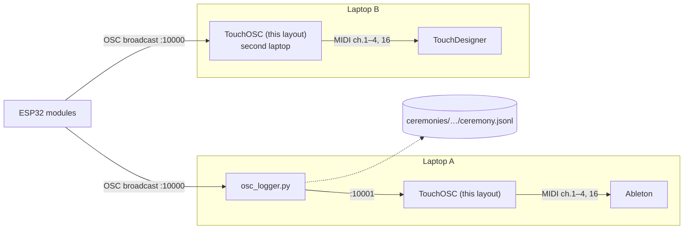

# Seventh Bowl — TouchOSC bridge

Sensor-to-MIDI bridge for *Seventh Bowl*, a tea-ceremony performance. ESP32 modules (HX711 load cells under the gaiwan and four cups, an IMU in the pitcher) send **OSC** to **TouchOSC**; a Lua script in the layout turns the readings into **MIDI** for Ableton Live and TouchDesigner.

The module firmware is not part of this repository. `osc_logger.py` records each ceremony (see *Recording a ceremony*).



## What it reports

Each **cup** has its own MIDI channel (cup N → channel N) with two CCs and two notes:

- **CC 1 — FULL**: 0 = empty / waiting / drunk, 127 = poured (at least the "FULL" setting of a pour) and not yet drunk.
- **CC 2 — LIFTED**: 0 = on the scale, 127 = lifted off (stays 0 until the cup has been on the scale once).
- **Note 36** — note-on + note-off together when the cup is **lifted**.
- **Note 37** — note-on + note-off together when the cup is **put back**.

Both CCs ramp (rise / fall seconds are faders, shared by all cups); the notes are immediate. A full cup that is put back lighter by the "DRUNK" setting of what was poured counts as drunk and CC 1 goes to 0.

The **gaiwan sends no MIDI**: water poured into it only counts the rounds. **Rounds** (channel 16): one note-on per change, velocity 127, note = 0 + max(count, 0), no note-off, no CC; +1 each time water goes into the gaiwan, or by hand; may go below 0 for a warming round; every change resets the cups. **Pitcher** (channel 16): tilt as CC 30 (angle from a captured ZERO pose, 0 below 10°).

The amount of tea is deliberately not reported: a load cell reads weight × lever arm, so the same vessel gives very different numbers depending on where it stands. FULL and DRUNK are detected from *events* (a pour, a put-down that is lighter) instead.

Every output has a button on screen (the CC 1 and CC 2 toggles; tapping LIFTED also fires the lift / put note). The SETTINGS column has faders for FULL (0.5 = half full), DRUNK, the four ramp times and GAIW (the gaiwan's own FULL, 0.6); they are saved with the layout, like the calibration.

**Round counting (gaiwan)** is judged by *level*, not by a state: the gaiwan is "full" when its settled weight is at least GAIW × a pour (`pour`, 140k counts) above its empty level, and counts again after it falls back near empty (`REARM`) or is emptied while away. The empty level is the highest settled non-full weight of the last 60 s (`EMPTY_WIN_S`), so a lid off-and-on or small drift is not a pour. A rise of more than `PUSH_POURS` (1.4) pours is a push or a hand, never water. Rounds closer than 3 s apart are ignored, and the round status line shows why the last count happened. A finger pressing on the gaiwan read +71k and a small real fill +75k, so GAIW 0.6 favours rejecting the finger; set 0.5 to count small fills.

## MIDI map

| | channel | CC | notes |
|---|---|---|---|
| cup 1 / 2 / 3 / 4 | 1 / 2 / 3 / 4 | 1 = FULL, 2 = LIFTED | 36 = lifted, 37 = put back |
| gaiwan | – | – | – |
| rounds | 16 | – | 0 + round (note-on only) |
| pitcher | 16 | 30 = tilt | – |

Lift and put-back are detected from the *movement*: a drop of `LIFT_STEP` (0.2 of an empty cup) within 0.4 s from a loaded weight is a lift, a rise of the same size from the lowest point is a put-back, so the note comes with the hand (about 0.1 s) and not when the weight crosses the half-way line. The slower on-the-scale test remains as a fallback.

The CC numbers, notes and channels are at the top of `build_okuma_layout.py` (`CC_FULL`, `CC_LIFT`, `NOTE_LIFT`, `NOTE_PUT`, `channel=` per module).

## OSC inputs

`/okuma/gaiwan`, `/okuma/cup1` … `/okuma/cup4` (raw HX711 counts), `/okuma/imu1/tilt` and `/okuma/imu1/dir` (pitcher). The pitcher also sends `/okuma/imu1/battery`; the load cells' battery addresses are listened to but unused until their firmware sends one. Receive port is set in TouchOSC: **10001** on the laptop that runs the logger (the logger takes 10000), **10000** on the other.

## Build

Only the Python standard library is needed.

```
python3 build_okuma_layout.py          # writes okuma_bridge.tosc and okuma_bridge.lua
python3 build_okuma_layout.py --xml    # also the readable XML
```

Open `okuma_bridge.tosc` in TouchOSC. The committed `okuma_bridge.tosc` is the built layout. All sensors, CCs, timings and thresholds are in the CONFIG section of `build_okuma_layout.py`; behaviour is in `okuma_bridge.template.lua`. TouchOSC's Lua is a small Lua 5.1 (no `setmetatable`, `pcall`, `require` …), see the header of the template.

## Use

1. Per vessel (gaiwan and cups), with the scale empty press **NO**, then with the empty vessel standing press **EMPTY** (any order). The pour size per vessel is a setting in the config (in counts).
2. Press **ZERO** on the pitcher in its resting pose.
3. The big fader of each vessel is the input: OSC moves it, and a hand-drag feeds the logic the same way, so a whole ceremony can be played from the screen without sensors. Bottom = away, middle line = the empty vessel as it stands this round, top = one pour.

## Recording a ceremony

On the logger laptop:

```
pip install python-osc                         # once
python osc_logger.py "closed test, Dong Ding"  # the note is optional; without it, it asks
```

It prints the ports and the log path, then records every OSC message to `../ceremonies/<date>_<time> <note>/ceremony.jsonl` (the `ceremonies` folder sits next to this repo, outside git) and passes each one on to TouchOSC. Press **Enter** to mark a moment (type a word first to label it), **Ctrl+C** to stop. The log's first line holds the start time and the note; the format is described at the top of `osc_logger.py`. Drop the log into studio.seventhbowl.com/ceremony/ to draw the night.

## Status

v7 is tested in a Lua 5.1 simulation and by replaying a recorded 40-minute ceremony log (6 rounds found at the right moments); testing on the real hardware is in progress. Pour sizes and thresholds come from one log and will need tuning.

Design notes and open points: [`docs/notes.md`](docs/notes.md). How OSC reaches the TouchOSC scripts (probe results): [`docs/osc-routing-probes.md`](docs/osc-routing-probes.md); the probe scripts are in the v4 commit.

## History

Earlier versions are in the git history, one commit per version (v1, v2, v3, v12, v4, v5, v6, v7); `git log -p` shows what changed. v5's notes, with the fixes made during its tests, are in the v5 commit (`docs/notes.md`).
